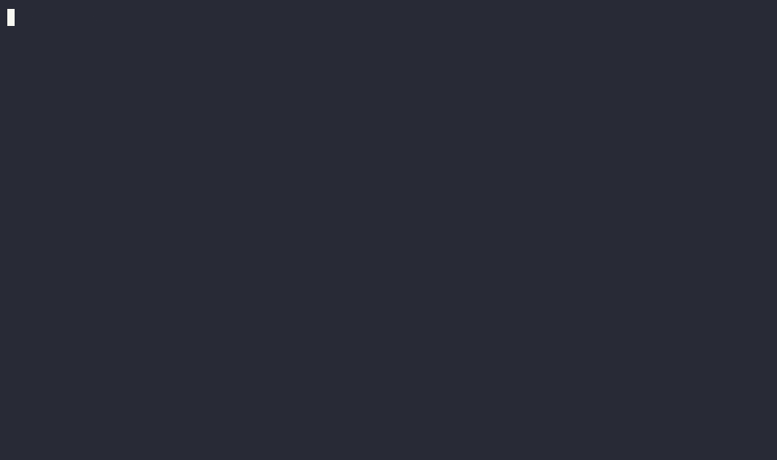

# claude-remote-dev

Run **Claude Code sessions server-side** on a VM inside the org perimeter, so
they keep working while your laptop is off. Reconnect from the laptop to review
changed files, answer questions, finish or start sessions.

Claude models are reached through one of four providers — **GCP Vertex AI**,
**Amazon Bedrock**, the **direct Anthropic API**, or an **Anthropic-compatible
LLM gateway** such as LiteLLM — chosen per VM and overridable per session.
Repositories can live on **GitLab or GitHub** (github.com and GitHub
Enterprise Server alike).

See the full design in
[`docs/superpowers/specs/2026-08-15-remote-claude-code-vm-design.md`](docs/superpowers/specs/2026-08-15-remote-claude-code-vm-design.md),
the multi-provider / multi-forge extension in
[`docs/superpowers/specs/2026-08-15-github-and-multi-provider-design.md`](docs/superpowers/specs/2026-08-15-github-and-multi-provider-design.md),
and the gateway provider in
[`docs/superpowers/specs/2026-11-24-llm-gateway-provider-design.md`](docs/superpowers/specs/2026-11-24-llm-gateway-provider-design.md).

## Daily use

The quickest way in is the interactive picker — run it on the VM:

```bash
rd-tui
```



It lists every session, running and stopped, and drives the other helpers:

| key | action |
| --- | --- |
| `↑` `↓` (or `k` `j`) | move |
| `enter` | attach; a stopped session is started first |
| `s` | stop (keeps the worktree and branch) |
| `u` | update Claude and restart the session, resuming its conversation |
| `x` | remove a stopped session's worktree |
| `n` | new session: pick a project (or **+ clone from URL…**), name it, pick feature/bugfix |
| `c` | clone a project from a git URL (name suggested from the repo), then start a session in it |
| `r` / `q` | refresh / quit |

Attaching replaces `rd-tui` with tmux, so `Ctrl-b` `d` returns you to the shell.
From the laptop, `./connect.sh --tui` (`.\connect.ps1 -Tui`, `connect.bat -Tui`)
opens it straight over SSH.

The same operations are available as plain commands:

```bash
rd-start backend                         # default session in ~/projects/backend
rd-start backend --session new-search    # feature/new-search in its own worktree
rd-start backend --session login-timeout --type bugfix
rd-start backend --session experiment --base origin/main
rd-start backend --session login-timeout --fresh  # new conversation instead of continuing
rd-start backend --session bedrock-try --provider bedrock   # override the default provider

rd-attach backend --session login-timeout    # detach: Ctrl-b then d
rd-stop backend --session login-timeout      # keep the worktree and branch
rd-update                                    # install the latest Claude (no-op if current)
rd-restart backend --session login-timeout   # restart on it, resume the conversation
rd-restart backend --update                  # both in one step
rd-remove backend --session login-timeout    # remove a clean, stopped worktree
rd-remove backend --session old-fix --delete-branch
rd-list                                    # running sessions
rd-list --all                              # also stopped worktree sessions
rd-list --porcelain --all                  # tab-separated, for scripts
```

Named worktrees live at `~/worktrees/<project>/<session>`. Their default branch
is `feature/<session>`; use `--type bugfix` for `bugfix/<session>`, `--branch`
for an explicit `feature/...` or `bugfix/...` name, and `--base` to override the
starting `HEAD`. Restarting an existing session reuses its worktree and branch,
so `--type` is only needed when it is first created. Project and session names
may contain letters, digits, `_`, and `-`. Tmux metadata prevents ambiguous
legacy names from being attached or stopped as the wrong session.

To clone and start in one command, run `rd-start backend <git-url> --session
new-search`. The laptop helpers can also start and attach directly:

```bash
./connect.sh backend --session new-search
# Windows PowerShell/cmd:
.\connect.ps1 backend -Session new-search -Type feature
connect.bat backend -Session new-search -Type feature
```

List sessions from the laptop without attaching:
```bash
./sessions.sh                      # Windows: sessions.bat  or  .\sessions.ps1
```

### Updating Claude under long-running sessions

Sessions live for days; Claude releases several times a week. A running
session keeps the binary it started with, so updating is two steps:
`rd-update` installs the new release once per VM (Claude is a root-owned npm
global, which its own auto-updater cannot write), and `rd-restart` moves one
session onto it. `rd-list` and `rd-tui` mark sessions on an older release with
`*` in the `CLAUDE` column, and show `ACTIVITY` (`idle` / `busy` / `exited`).

`rd-restart` restarts Claude in the same pane — same worktree, branch and
provider — and resumes the same conversation (`--resume <id>`; the id is
recorded by a hook `rd-claude` adds through `claude --settings`, so your
`~/.claude/settings.json` is untouched). It refuses while a turn is in
progress (exit 3) unless you pass `--force`. Sessions started before this
existed have no recorded state: the first restart needs `--force` and resumes
with `--continue`. Background processes Claude started in the pane die with
it; Docker containers keep running.

Starting a *stopped* session again — after `rd-stop`, or after the VM rebooted
— also picks up where it left off: `rd-start` runs Claude with `--continue`
when the worktree already has a conversation. Pass `--fresh` to start a new
one instead.

Typical loop: start a session, give Claude a task, **close your laptop**. Later,
reconnect (VS Code Remote-SSH for diffs, `rd-attach` for questions), review the
branch Claude committed to, and open a merge request.

## How it works

- **tmux** hosts each Claude Code session on the VM. A project can have a
  backward-compatible `default` session plus multiple named sessions.
- Every named session works in its own Git worktree and branch, so concurrent
  Claude processes never share a working tree or index.
- **systemd user service + `loginctl enable-linger`** keep the tmux server alive
  across disconnects and reboots.
- **VS Code Remote-SSH** is the primary client for reviewing diffs and editing;
  `tmux attach` is for answering Claude's questions.
- The **VM is the isolation boundary** — Claude runs natively (Variant A), so it
  can drive `docker compose` directly without docker-in-docker.

## Laptop OS

The laptop-side helpers (`connect.sh`, `bootstrap-remote.sh`) are Bash scripts:

- **macOS / Linux** — run them directly (`./connect.sh`).
- **Windows** — connect with `connect.bat` (double-click) or `.\connect.ps1`
  (PowerShell). For provisioning, run the Bash helper from **Git Bash**
  (`bash ./bootstrap-remote.sh`).

Everything that runs **on the VM** (`bootstrap.sh`, `rd-*`) is Linux-side and
unaffected by the laptop OS.

## Prerequisites

- An Ubuntu LTS VM reachable over SSH by key, with `sudo` that does not prompt
  for a password (bootstrap runs non-interactively). `git` is preinstalled on
  the VM (used to clone this repo).
- Network egress from the VM to apt, npm, `github.com`, `cli.github.com`,
  `gitlab.com` (for the `glab` package), your Git host, `mcp.atlassian.com`,
  and whichever model endpoint your provider uses — `*.googleapis.com` for
  Vertex, `bedrock-runtime.<region>.amazonaws.com` for Bedrock,
  `api.anthropic.com` for the direct API, your gateway's host for a gateway
  (verify — see the design doc's smoke test).
- Credentials for **one** provider: a Vertex-enabled GCP project, or Bedrock
  access (AWS SSO profile, Bedrock API key, or access keys), or an Anthropic
  API key / Claude subscription, or a gateway URL and key.

## Setup

1. **Configure** (laptop): copy and edit the config.
   ```bash
   cp rd.env.example rd.env
   # set VM_IP, VM_USER, SSH_KEY
   # set RD_PROVIDER and the block for that provider:
   #   vertex    -> GCP_PROJECT_ID, CLOUD_ML_REGION
   #   bedrock   -> AWS_REGION + one of AWS_PROFILE / AWS_BEARER_TOKEN_BEDROCK / access keys
   #   anthropic -> ANTHROPIC_API_KEY, or leave empty to use a Claude subscription
   #   gateway   -> ANTHROPIC_BASE_URL, ANTHROPIC_AUTH_TOKEN (+ optional switches)
   ```

2. **Provision the VM — one command from the laptop.** Set `REPO_URL` and a
   read-only `GIT_CLONE_TOKEN` in `rd.env` first (see `rd.env.example` for how to
   mint the token). Then:
   ```bash
   bash bootstrap-remote.sh
   ```
   This clones the repo onto the VM (stripping the token afterwards), copies
   `rd.env`, and runs `bootstrap.sh` on the VM — which installs Node/Claude Code,
   gcloud, `glab`, `gh`, the AWS CLI, Docker, tmux; writes the provider config;
   installs the `rd-*` helpers; installs the Atlassian (Jira) plugin; enables
   systemd/linger durability; and applies SSH hardening + unattended-upgrades.
   Idempotent.

3. **Authorize — one command on the VM.** Connect (`./connect.sh` /
   `.\connect.ps1`), then:
   ```bash
   rd-auth                      # default provider + the forge REPO_URL points at
   rd-auth --provider bedrock   # add a second provider later
   ```
   It logs in to the model provider and the forge, and wires git credentials
   **scoped to that forge host** so GitLab and GitHub never answer for each
   other. Per provider: Vertex finishes a Google ADC URL in your laptop browser;
   Bedrock with an SSO profile runs `aws sso login`; Bedrock with a static
   credential and Anthropic with an API key need no login; an Anthropic
   subscription runs `claude setup-token` and stores the token in
   `~/.config/rd/providers/anthropic.env` (mode 0600); a gateway needs no
   login either — rd-auth checks that `<url>/v1/models` accepts the key. For
   Jira, start `claude` once and trigger a Jira action to complete its OAuth.

## Model providers

The VM's default provider is `RD_PROVIDER` in `rd.env`; `bootstrap.sh` turns
each configured provider into a file under `~/.config/rd/providers/` (mode
0600) and records the default in `~/.config/rd/provider`. A tmux pane is a
login shell, so `~/.profile` sources exactly one of those files at start.

```bash
rd-start backend --provider bedrock   # this session only
rd-list                               # PROVIDER column shows what each session runs on
```

Only the provider *name* is passed to tmux — credentials stay in the 0600 file,
out of `ps` output and out of the tmux session environment. `rd-start` passes
it for every new session, the VM default included. Before loading the named
file, `~/.profile` unsets every provider switch and credential Claude reads —
the `CLAUDE_CODE_USE_*` provider switches, `ANTHROPIC_API_KEY`,
`CLAUDE_CODE_OAUTH_TOKEN`, `ANTHROPIC_BASE_URL`, `ANTHROPIC_AUTH_TOKEN`,
`AWS_BEARER_TOKEN_BEDROCK`, the gateway switches and the
`ANTHROPIC_DEFAULT_*_MODEL` pins — so whatever a pane inherited (a tmux server
started by hand keeps its shell's environment), it runs exactly one provider.
General AWS credentials (`AWS_PROFILE`, `AWS_REGION`, the key pair) and gcloud
are left alone.

That clearing runs in every login shell, interactive SSH logins included, so
it also drops your own `~/.bashrc` exports of those names there (a non-login
shell, such as VS Code's terminal, reads them again). Keep an application's
`ANTHROPIC_API_KEY` in its project `.env` or compose `env_file`, and Claude
preferences such as model pins in the `env` block of `~/.claude/settings.json`.

**A running session's provider cannot change.** The pane's environment is fixed
when it starts, so `rd-start … --provider` against a running session is
rejected; `rd-stop` it first and start it again.

Bedrock has two caveats worth knowing:

- **Pin your models.** Without `ANTHROPIC_DEFAULT_OPUS_MODEL` /
  `…_SONNET_MODEL` / `…_HAIKU_MODEL` in `rd.env`, the `opus` and `sonnet`
  aliases resolve to Claude Code's built-in Bedrock defaults, which may not be
  enabled in your account — the session then quietly falls back to a lower-tier
  model. (`~/.claude/settings.json` ships `"model": "opus[1m]"`, which is a
  Vertex/Anthropic-shaped value.)
- **WebSearch is unavailable on Bedrock.** Sessions there simply do not get
  that tool.

### LLM gateway

A gateway — LiteLLM, or any proxy that speaks the Anthropic API — is set with
`ANTHROPIC_BASE_URL` and `ANTHROPIC_AUTH_TOKEN` (the gateway's own key, sent
as `Authorization: Bearer`) in `rd.env`. `bootstrap.sh` writes
`~/.config/rd/providers/gateway.env` from them, plus `ENABLE_TOOL_SEARCH`,
`CLAUDE_CODE_ENABLE_GATEWAY_MODEL_DISCOVERY` and
`CLAUDE_CODE_MAX_CONTEXT_TOKENS` when those are set; `RD_PROVIDER="gateway"`
makes it the default. Single-quote the key in `rd.env` (the template does):
the file is sourced, so inside `"…"` a `$`, `` ` `` or `\` would be expanded.
From there on it is single-quoted in `gateway.env` too, so a key holding `$`
or `&` reaches the shell and `rd-auth` intact.

- **No other provider's switch or credential survives into a gateway session
  — or out of one.** `CLAUDE_CODE_USE_VERTEX` and `CLAUDE_CODE_USE_BEDROCK` win over
  `ANTHROPIC_BASE_URL`, an inherited `ANTHROPIC_API_KEY` would be sent to the
  gateway, and an inherited `ANTHROPIC_BASE_URL` would send an `anthropic`
  session's traffic and key there. The clearing in `~/.profile` (above)
  handles all of it. The `env` block and `apiKeyHelper` of
  `~/.claude/settings.json` are applied by Claude itself, after the shell, so
  keep provider settings out of them.
- **Model pins must use the gateway's names.** A Vertex id such as
  `claude-haiku-4-5@20251001` in an `ANTHROPIC_DEFAULT_*_MODEL` pin — easily
  left in `~/.claude/settings.json` by an earlier Vertex setup — is rejected
  by a LiteLLM gateway ("no healthy deployments"), and every call to that
  model fails; for Haiku that is background work you never see failing. The
  gateway's `/v1/models` lists the names it serves.
- **Usage metrics come back on.** Claude Code keeps its metrics and `/feedback`
  uploads off by default only on Vertex, Bedrock and Foundry; behind a gateway
  it runs in Claude-API mode, where both are on. If your organisation wants
  them off, set `DISABLE_TELEMETRY=1` and `DISABLE_FEEDBACK_COMMAND=1` — or
  `CLAUDE_CODE_DISABLE_NONESSENTIAL_TRAFFIC=1`, which also stops feature-flag
  evaluation — in the `env` block of `~/.claude/settings.json`.

### Removing a provider

`bootstrap.sh` writes provider files but never deletes one. To retire a
provider — say, moving a VM from Vertex to a gateway — clear its values in
`rd.env` (or a re-run writes the file back), set `RD_PROVIDER`, re-run
`bootstrap.sh`, delete `~/.config/rd/providers/<name>.env`, and `rd-stop` /
`rd-start` the running sessions: a pane keeps the environment it started
with. Logins you still use for development, such as `gcloud auth` and its ADC,
are separate and stay as they are.

## GitLab and GitHub

Both CLIs are installed and neither is wrapped: `gh` and `glab` read the
repository's own `origin` remote, so in a GitHub checkout `gh pr create` works
and in a GitLab checkout `glab mr create` works, with no per-repo setup.
`rd-auth` logs in to the forge `REPO_URL` points at and scopes git credentials
to that host; run it again with `--forge`/host arguments to add the other one.

Neither merge is one-shot — confirm before moving on:

- **GitLab:** `glab mr merge <iid> --squash` prints "✓ Merged!" while possibly
  only setting `merge_when_pipeline_succeeds`. Check
  `glab api projects/:id/merge_requests/<iid>` for `state: merged`.
- **GitHub:** `gh pr merge <n> --squash` queues the merge when required checks
  are pending, and branch protection can reject a merge the CLI reported as
  submitted. Check `gh pr view <n> --json state,mergedAt`.

## VS Code (Remote-SSH)

Use VS Code as the client for browsing diffs and editing files on the VM.

1. Install the **Remote - SSH** extension (`ms-vscode-remote.remote-ssh`).
2. Add the VM to your SSH config (`~/.ssh/config`, or `%USERPROFILE%\.ssh\config`
   on Windows):
   ```
   Host dev-vm
       HostName <vm-ip>
       User <vm-user>
       IdentityFile ~/.ssh/<key>.pem
   ```
3. `F1` → **Remote-SSH: Connect to Host…** → pick `dev-vm`.
4. Configure automatic attach once for each project, from a VM terminal:
   ```bash
   rd-vscode-init ~/projects/backend
   ```
   Commit the resulting `.vscode/tasks.json` if teammates should inherit it.
   Run this before creating named worktrees, or run it separately in an already
   existing worktree.
5. **File → Open Folder…** and open the exact working tree:
   `/home/<vm-user>/projects/backend` for `default`, or
   `/home/<vm-user>/worktrees/backend/login-timeout` for that named session.
6. On the first open, trust the workspace and allow automatic tasks. VS Code
   opens a dedicated terminal and runs `rd-attach-here`, which reads tmux
   metadata and attaches the matching session. Review changes in **Source
   Control** (`Ctrl+Shift+G`).

VS Code installs its server component on the VM automatically on first connect.
If no matching session is running, the task terminal explains how to start one.

## Syncing Claude memory

Claude Code stores per-project memory under
`~/.claude/projects/<encoded-absolute-path>/memory/`, keyed by the project's
**absolute path** — which differs between the laptop and the VM. `sync-memory.sh`
maps the paths and copies the `memory/` folder across:

```bash
./sync-memory.sh push <project-name>   # laptop -> VM (seed the VM with your memory)
./sync-memory.sh pull <project-name>   # VM -> laptop (bring back memory made on the VM)
```

`<project-name>` is the project folder's basename (e.g. `project1`);
the VM path defaults to `/home/<VM_USER>/projects/<project-name>`. Files are
copied/overwritten, not merged — run `push` to seed, `pull` to retrieve.

For knowledge you want to be portable by design, prefer committing it to
`CLAUDE.md` / `AGENTS.md` in the repo: that travels with `git` and is
path-independent.

## Security

The VM is treated as a **disposable sandbox**. Because Claude runs autonomously
with Docker access, it is effectively root-equivalent *inside* the VM — so
protection lives at the VM boundary:

- key-only SSH, no root login (applied by bootstrap);
- automatic security updates;
- VM snapshots + a Git remote as source of truth for recovery;
- **recommended next step:** enable the egress allowlist in
  [`hardening/egress-allowlist.nft`](hardening/egress-allowlist.nft) to bound
  what the agent can reach. Test before enabling on boot.

Each teammate uses their **own VM** and their **own** provider login (`gcloud`
ADC, AWS SSO, an Anthropic token, or a personal gateway key), keeping the
audit trail clean. Provider
credentials live in `~/.config/rd/providers/*.env` at mode 0600 and are never
written to a tracked file.

## Layout

```
bootstrap.sh                 # idempotent VM installer (run ON the VM)
bootstrap-remote.sh          # laptop-side: clone repo onto the VM, copy rd.env, run bootstrap
connect.sh / .ps1 / .bat     # laptop-side SSH helper (reads rd.env); --tui / start+attach
sessions.sh / .ps1 / .bat    # laptop-side: list VM sessions without attaching
sync-memory.sh               # laptop-side: push/pull ~/.claude/projects/<path>/memory
rd.env.example               # config template -> copy to rd.env (gitignored)
DEV.md                       # contributor notes (Windows: Hyper-V smoke-test VM)
bin/rd-*                     # tmux session helpers, installed to ~/.local/bin
bin/rd-auth                  # one-command VM authorization (provider + forge + git author)
bin/rd-tui                   # interactive picker; shells out to the other rd-*
bin/rd-vscode-init           # writes a project-scoped automatic attach task
bin/rd-attach-here           # attaches the session owning the opened worktree
bin/rd-claude                # launches Claude with the rd hooks (--settings)
bin/rd-claude-hook           # hook: records conversation id + idle/busy in tmux
bin/rd-restart               # restart a session on the installed Claude, resume it
bin/rd-update                # install the latest Claude (no-op if current)
tmux.conf                    # installed to ~/.tmux.conf (mouse scrolling) if absent
tests/lib.sh, tests/stubs/   # shared test helpers and the tmux/ssh/claude stubs
tests/smoke/                 # real-tmux and real-bootstrap smoke runs (no stubs)
systemd/tmux-claude.service  # persistent tmux user service
hardening/                   # sshd drop-in, unattended-upgrades, egress allowlist
docs/superpowers/specs/      # design documents
docs/superpowers/plans/      # implementation plans
```

Provider config written by `bootstrap.sh` (on the VM, not tracked):

```
~/.config/rd/provider              # default provider name for new sessions
~/.config/rd/providers/<name>.env  # 0600, sourced by ~/.profile for that provider
~/.config/rd/claude-settings.json # rd hooks, rewritten by rd-claude on every launch
```
